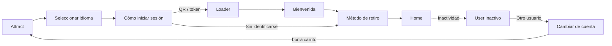

# Home, Login, Idiomas y Métodos de retiro

## 1. Contexto

Entrada al kiosco: Attract → idioma → identificación opcional con **token / QR** desde la App → método de retiro → Home. Cubre además la gestión de sesión en un dispositivo compartido: inactividad, cambio de cuenta, log out con y sin carrito, y errores de identificación.

## 2. Flujos relevados

Ver inventario con node IDs en [`mapa-de-flujos.md § 1`](../../docs/mapa-de-flujos.md#1--adk-login--cjxvzun17o3sgykfiuxskm): 12 flujos en *Nuevo Login (con Token)* y 4 variantes de Home (logueado / no, con / sin Loyalty, con / sin carrito).

## 3. Puntos a definir en la auditoría

| Tema | Pregunta | Regla |
|---|---|---|
| Inactividad | Tiempo, cuenta regresiva y qué se borra | K-SES-01 · K-SES-02 |
| Cambio de cuenta | ¿El usuario entiende que pierde el carrito antes de confirmar? | K-TOQ-04 · voz y tono *Confirmaciones* |
| Modales de error (`identificationError`, `identificationUpgradingError`, `unauthorized`) | Acción primaria y salida clara | K-DEC-03 · K-LEG-07 |
| Footer V2 con accesibilidad | Comportamiento del modo accesible en Attract y Home | K-ALC-02 · K-ALC-04 |
| Gobernanza | Todo el archivo está Ready for Dev (confirmado), pero no tiene páginas READY / PENDIENTES como los otros dos: conviene agregarlas | — |

## 4. Hallazgos abiertos

| ID | Hallazgo | Prioridad | Estado |
|---|---|---|---|
| [F-001-01](../../audits/001-flujos-kiosco.md#f-001-01) | No hay modo accesible diseñado: las decisiones obligatorias quedan en `y 496–1008`, fuera de la Safe Area | 🔴 P0 | Pendiente |
| [F-001-05](../../audits/001-flujos-kiosco.md#f-001-05) | Idiomas nombrados en español ("Inglés", "Portugués") | 🟠 P1 | Pendiente |
| [F-001-06](../../audits/001-flujos-kiosco.md#f-001-06) | Errores con una sola salida "Volver" y sin siguiente paso (identificación, cupones, FLEX, ticket no impreso) | 🟠 P1 | Pendiente |
| [F-001-08](../../audits/001-flujos-kiosco.md#f-001-08) | Inactividad sin cuenta regresiva visible | 🟠 P1 | Pendiente |
| [F-001-14](../../audits/001-flujos-kiosco.md#f-001-14) | Nombre y puntos del usuario visibles para la fila | 🟡 P2 | Pendiente |
