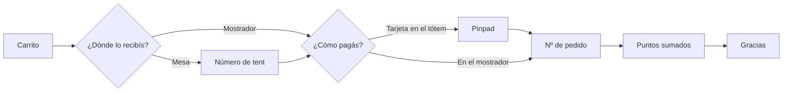

# Checkout — método de retiro y pago

## 1. Contexto

Combina **dónde se consume** (comer aquí / para llevar), **dónde se entrega** (mostrador / mesa con número de tent) y **dónde se paga** (mostrador / tarjeta en el tótem). Termina en número de pedido, puntos sumados (estático o animado) y gracias.

## 2. Matriz de caminos

| Consumo | Pago | Entrega | Node |
|---|---|---|---|
| Comer aquí | Mostrador | Mostrador | `52:5990` · `52:6048` |
| Comer aquí | Mostrador | Mesa (tent) | `52:6104` · `52:6190` |
| Comer aquí | Tótem (tarjeta) | Mesa (tent) | `52:6274` |
| Comer aquí | Tótem (tarjeta) | Mostrador | `52:6364` |
| Para llevar | Mostrador | Mostrador | `52:6429` · `52:6526` |
| Para llevar | Tótem (tarjeta) | Mostrador | `52:6477` |

> **Pinpad caído:** las variantes `52:6049`, `52:6192`, `52:6528`, `154:12971` y `71:11337` muestran sólo *Pagar en el mostrador con efectivo*. Es el fallback de outage del pinpad, no una configuración por mercado.

## 3. Medidas relevadas (metadata)

| Pantalla | Elemento | Posición / tamaño | Regla en juego |
|---|---|---|---|
| Selección de tipo de pago | Opción principal (`Button illustration`) | 344 × 440 · `y 496–936` | K-ALC-02 |
| Selección de tipo de pago | Botón alternativo (`ADK Buttons`) | 504 × 80 · `y 1176` | ✅ K-TOQ-02 |
| Selección de tipo de pago | "¿Quieres factura electrónica?" → botón | **144 × 40** · `y ≈ 1358` | K-TOQ-01 |
| Selección método de retiro | 2 opciones `Button illustration` | 344 × 440 · `y 568–1008` | K-ALC-02 · K-ALC-04 |
| Pago con tarjeta | Ilustración *Pay Here* + instrucción del pinpad | 656 × 656 · `y 568` | K-LEG-06 |
| Nº de pedido | Número | 220 × 136 · `y 448` | K-LEG-03 |

## 4. Puntos a definir en la auditoría

| Tema | Pregunta | Regla |
|---|---|---|
| Orden de las preguntas | Confirmar que el orden (retiro → pago) es el mismo en los 6 caminos | Modelo mental · consistencia |
| Número de tent | Teclado y validación del número | K-TOQ-01 · K-LEG-07 |
| Animación de puntos | Duración y que no retrase el cierre | Peak-End · K-SES-04 |

## 5. Hallazgos abiertos

| ID | Hallazgo | Prioridad | Estado |
|---|---|---|---|
| [F-001-01](../../audits/001-flujos-kiosco.md#f-001-01) | No hay modo accesible diseñado: las decisiones obligatorias quedan en `y 496–1008`, fuera de la Safe Area | 🔴 P0 | Pendiente |
| [F-001-03](../../audits/001-flujos-kiosco.md#f-001-03) | Controles de 40 px en acciones del flujo principal (personalizar, seleccionar, cantidad, factura, quitar descuento) | 🟠 P1 | Pendiente |
| [F-001-04](../../audits/001-flujos-kiosco.md#f-001-04) | "Vaciar carrito" pegado a la acción principal en el footer de Home, Detalle y Tipo de pago | 🟠 P1 | Pendiente |
| [F-001-09](../../audits/001-flujos-kiosco.md#f-001-09) | Fallback de pinpad caído presentado como decisión de una sola opción, sin explicar por qué falta la tarjeta | 🟠 P1 | Pendiente |
| [F-001-16](../../audits/001-flujos-kiosco.md#f-001-16) | Typos en copy final: "pedidoo", "diponible" | 🟡 P2 | Pendiente |
