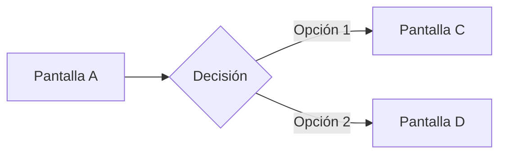

# <Nombre del feature>

## 1. Contexto y objetivo

- **Problema que resuelve:** …
- **Usuario y situación:** de pie / silla de ruedas, apurado, en el local. ¿Logueado? ¿Con carrito?
- **Métrica de éxito:** tiempo de orden, tasa de abandono en el paso, errores por sesión…

## 2. Flujo

| # | Pantalla | Node | Entrada | Salida |
|---|---|---|---|---|
| 1 | … | [`0:0`](https://www.figma.com/design/<key>/?node-id=0-0) | … | … |

## 3. Anatomía por pantalla

| Zona | `y` | Componentes (`[ADK] Design System`) | Regla de alcance |
|---|---|---|---|
| Header | 0–192 | `Header` | Sólo información |
| Contenido | 192–1656 | … | K-ALC-01 / 02 |
| Footer | 1656–1920 | `Footers_shell` (variante …) | CTA de compromiso |

## 4. Estados y casos borde

| Caso | Comportamiento | Pantalla |
|---|---|---|
| Vacío | … | |
| Error de integración / sin stock | … | |
| Inactividad | Aviso + cuenta regresiva (K-SES-01) | |
| Modo accesible | Qué baja a la Safe Area (K-ALC-02) | |

## 5. Contenido (copy)

| Key | Texto fuente (neutral, tú) | Adaptación AR/UY (vos) | Contexto de voz y tono |
|---|---|---|---|
| `…` | … | … | Problemas y recuperación / Confirmaciones / Esperas… |

## 6. Accesibilidad

- Contraste de texto y estados (K-LEG-03, K-LEG-04).
- Segundo indicador además del Gold (K-LEG-05).
- Foco visible si el mercado tiene teclado o switch (Audit DS A-C01).
- Errores con ícono + texto (K-LEG-07).

## 7. Justificación de decisiones

| Decisión | Por qué | Base |
|---|---|---|
| … | … | [Ley de …](../../Base-de-conocimiento/leyes-de-ux.md) · K-… · WCAG … |

## 8. Hallazgos abiertos

| ID | Hallazgo | Prioridad | Estado |
|---|---|---|---|
| — | — | — | — |

## 9. Handoff

- Tokens: ArchWay Semantic (ver [`adk.tokens.json`](../../Archway/ADK/tokens/adk.tokens.json)).
- Componentes Vue: [`Archway/ADK/ui`](../../Archway/ADK/ui).
- Eventos de analytics: …
- Dependencias de backend: …
