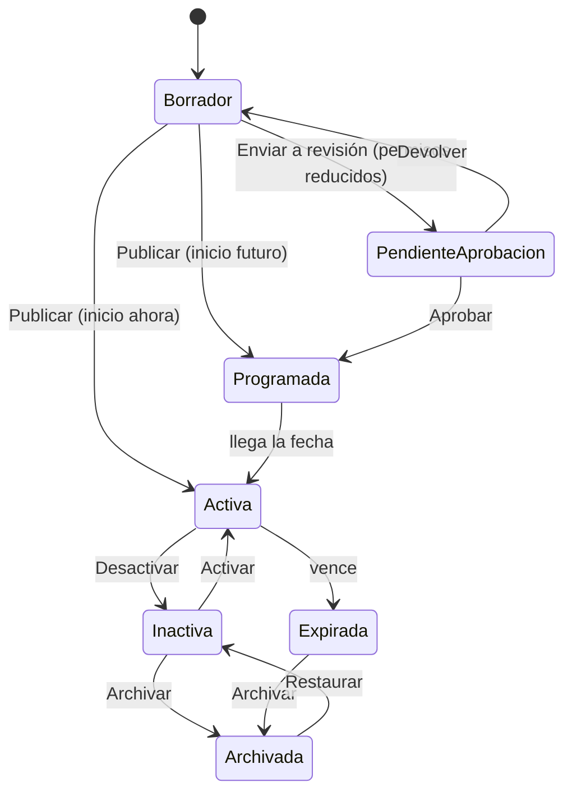

# Promociones — creación, segmentación y reglas

> Ficha armada desde la [arquitectura de la información](../../../Archway/Dashboard/structure/information-architecture.md) (v-03/11/26) y el relevamiento de Figma del 2026-11-17 (inventario completo en [`mapa-de-flujos.md`](../../docs/mapa-de-flujos.md)). Las secciones vacías se completan con [`templates/design.md`](../../templates/design.md) a medida que se audita cada flujo.

## 1. Contexto y objetivo

- **Qué gobierna:** Creación de cupones y ofertas, segmentación por restaurante y usuario, reglas de negocio y vigencia.
- **Quién lo usa:** *pendiente*
- **Riesgo operativo:** ver [mapa de módulos](../../docs/mapa-de-modulos.md)
- **Métrica de éxito:** *pendiente*

## 2. Contexto en la IA

Listado en **Card List** (cada promoción se activa y cambia de estado). Alta en **paso a paso** (ejemplo en Figma, [page-templates](../../../Archway/Dashboard/usage/page-templates.md#2-left-panel--flujo-paso-a-paso)): Descuento → Detalles generales → Disponibilidad → Segmentación → Contenido de apoyo → Revisión con `Card_Descripcion`. Segmentación con listas duales (disponibles con búsqueda, *Subir CSV*, *Limpiar filtros* → seleccionados) y `Card_Info` de resumen a la derecha. Además, Country › Promotions y Special Sales (McDía) configuran el motor por país.

## 3. Flujo en Figma

### [[DashBoard] Promociones](https://www.figma.com/design/eY15rEgfQpHeY2H50TkbKW/) · `eY15rEgfQpHeY2H50TkbKW` · In Progress · editado 2026-11-16

| Página | Flujos / secciones |
|---|---|
| [⮑ Promociones](https://www.figma.com/design/eY15rEgfQpHeY2H50TkbKW/?node-id=2050-17859) | [Listado (PROM_PromotionList)](https://www.figma.com/design/eY15rEgfQpHeY2H50TkbKW/?node-id=4710-53972) · [Listado · más filtros](https://www.figma.com/design/eY15rEgfQpHeY2H50TkbKW/?node-id=4482-119554) · [Listado · menú contextual](https://www.figma.com/design/eY15rEgfQpHeY2H50TkbKW/?node-id=4712-53176) · [Responsive](https://www.figma.com/design/eY15rEgfQpHeY2H50TkbKW/?node-id=5106-58808) · [Crear · descuento a empleados](https://www.figma.com/design/eY15rEgfQpHeY2H50TkbKW/?node-id=4381-49733) · [Crear · subtipo automático](https://www.figma.com/design/eY15rEgfQpHeY2H50TkbKW/?node-id=4388-22443) · [Crear · descuento de envío](https://www.figma.com/design/eY15rEgfQpHeY2H50TkbKW/?node-id=4393-26976) · [Crear · código (35 pantallas)](https://www.figma.com/design/eY15rEgfQpHeY2H50TkbKW/?node-id=4379-29685) · [Crear · código % producto / comportamiento del cupón](https://www.figma.com/design/eY15rEgfQpHeY2H50TkbKW/?node-id=4538-65752) · [Crear · subtipo de código](https://www.figma.com/design/eY15rEgfQpHeY2H50TkbKW/?node-id=4663-47264) · [Subcódigos dinámicos](https://www.figma.com/design/eY15rEgfQpHeY2H50TkbKW/?node-id=8890-88461) · [Guardar como borrador](https://www.figma.com/design/eY15rEgfQpHeY2H50TkbKW/?node-id=5419-63068) · [Ver / editar](https://www.figma.com/design/eY15rEgfQpHeY2H50TkbKW/?node-id=4379-49729) · [Ver / editar · cursor not-allowed](https://www.figma.com/design/eY15rEgfQpHeY2H50TkbKW/?node-id=5107-59738) · [Archivada](https://www.figma.com/design/eY15rEgfQpHeY2H50TkbKW/?node-id=8433-84467) · [Archivar](https://www.figma.com/design/eY15rEgfQpHeY2H50TkbKW/?node-id=4486-81393) · [Duplicar](https://www.figma.com/design/eY15rEgfQpHeY2H50TkbKW/?node-id=4486-91463) · [Desactivar](https://www.figma.com/design/eY15rEgfQpHeY2H50TkbKW/?node-id=7806-131212) · [Activar](https://www.figma.com/design/eY15rEgfQpHeY2H50TkbKW/?node-id=7806-134523) · [Volver](https://www.figma.com/design/eY15rEgfQpHeY2H50TkbKW/?node-id=7806-148868) · [Cancelar](https://www.figma.com/design/eY15rEgfQpHeY2H50TkbKW/?node-id=4486-107135) · [Error al activar/desactivar](https://www.figma.com/design/eY15rEgfQpHeY2H50TkbKW/?node-id=7806-135153) · [Aviso de porcentaje](https://www.figma.com/design/eY15rEgfQpHeY2H50TkbKW/?node-id=8277-101401) · [Notificación](https://www.figma.com/design/eY15rEgfQpHeY2H50TkbKW/?node-id=7806-161061) · [Medidas / paso a paso](https://www.figma.com/design/eY15rEgfQpHeY2H50TkbKW/?node-id=7323-93842) · [Change Log](https://www.figma.com/design/eY15rEgfQpHeY2H50TkbKW/?node-id=8496-182257) |
| [⮑ Por método de pago](https://www.figma.com/design/eY15rEgfQpHeY2H50TkbKW/?node-id=8402-127709) | [Crear · método de pago · % orden](https://www.figma.com/design/eY15rEgfQpHeY2H50TkbKW/?node-id=8402-130962) · [% producto](https://www.figma.com/design/eY15rEgfQpHeY2H50TkbKW/?node-id=8402-132023) · [Monto producto](https://www.figma.com/design/eY15rEgfQpHeY2H50TkbKW/?node-id=8402-133124) · [Precio fijo de producto](https://www.figma.com/design/eY15rEgfQpHeY2H50TkbKW/?node-id=8402-134227) · [Pix](https://www.figma.com/design/eY15rEgfQpHeY2H50TkbKW/?node-id=8402-172567) |

### Lo que se ve en el archivo

- Es el archivo más grande y el más reciente (editado el 16/11). Ya cubre el **ciclo de vida completo**: borrador, activar, desactivar, archivar (= soft-delete, BO-SEG-02), duplicar, volver, ver/editar con campos bloqueados.
- Tipos de alta: código (35 pantallas), subtipo de código, subcódigos dinámicos, automática, descuento a empleados, descuento de envío y **por método de pago** (% orden, % producto, monto, precio fijo, Pix) en su propia página.
- Hay notas de flujo en texto ("Tipos de promociones: PUBLICAR", "Advertencia", "EDITAR / ELIMINAR / DUPLICAR / DESACTIVAR / VOLVER / NOTIFICACIÓN") y medidas del paso a paso.
- Secciones duplicadas con el mismo nombre (*Promotions / CTA*, *PROM_Create_Shipping_Discount*, *PROM_Archivar*, *PROM_Deactivate*): confirmar cuál es la vigente.
- Auditado en [Audit 001](../../audits/001-promociones.md) (2026-11-17).

## 4. Puntos a definir

- Primer candidato a auditoría (más pasos, más riesgo).
- Resumen de alcance antes de publicar (BO-SEG-03) y vigencia con zona horaria (BO-SEG-06).
- Duplicar promoción como atajo de alta (BO-FOR-02).
- [Q-03](../../docs/preguntas-abiertas.md): panel vs. Country.

## 5. Estados de la promoción (propuesta, DF-001-05)

Hoy Figma muestra tag + estado + toggle con 9 combinaciones (Activa, Próxima, Inactiva, Expirada, Pendiente de publicar, Publicando, Borrador, Archivada, Publicada). Pendiente de validar con producto.

## 6. Hallazgos abiertos

| ID | Hallazgo | Prioridad | Estado |
|---|---|---|---|
| [DF-001-01](../../audits/001-promociones.md#df-001-01--activar-desde-el-toggle-no-tiene-flujo) | Activar desde el toggle no tiene flujo | 🔴 P0 | Pendiente |
| [DF-001-02](../../audits/001-promociones.md#df-001-02--publicar-sin-alcance-ni-zona-horaria) | Publicar sin alcance ni zona horaria | 🟠 P1 | Pendiente |
| [DF-001-03](../../audits/001-promociones.md#df-001-03--archivar-no-se-puede-deshacer) | Archivar no se puede deshacer; toast dice "eliminada" | 🟠 P1 | Pendiente |
| [DF-001-04](../../audits/001-promociones.md#df-001-04--volver-y-cancelar-pierden-datos) | Volver y Cancelar pierden datos; borrador sólo al final | 🟠 P1 | Pendiente |
| [DF-001-05](../../audits/001-promociones.md#df-001-05--tres-indicadores-de-estado) | Tres indicadores de estado superpuestos | 🟠 P1 | Pendiente |
| [DF-001-06](../../audits/001-promociones.md#df-001-06--el-listado-no-dice-dónde-aplica) | El listado no dice dónde aplica; sin acciones masivas | 🟠 P1 | Pendiente |
| [DF-001-07](../../audits/001-promociones.md#df-001-07--desactivar-con-cta-ambiguo) | Desactivar con CTA "Actualizar" | 🟠 P1 | Pendiente |
| [DF-001-08](../../audits/001-promociones.md#df-001-08--error-sin-recuperación) | Error de cambio de estado sin recuperación | 🟠 P1 | Pendiente |
| [DF-001-09](../../audits/001-promociones.md#df-001-09--steppers-distintos-según-el-tipo) | Steppers distintos según el tipo | 🟡 P2 | Pendiente |
| [DF-001-10](../../audits/001-promociones.md#df-001-10--dos-primarios-en-disponibilidad) | Dos primarios en Disponibilidad | 🟡 P2 | Pendiente |
| [DF-001-11](../../audits/001-promociones.md#df-001-11--duplicar-pide-confirmación) | Duplicar pide confirmación | 🟡 P2 | Pendiente |
| [DF-001-12](../../audits/001-promociones.md#df-001-12--revisión-final-con-placeholders) | Revisión final con placeholders | 🟡 P2 | Pendiente |
| [DF-001-13](../../audits/001-promociones.md#df-001-13--tres-registros-e-inglés) | Tres registros e inglés | 🟡 P2 | Pendiente |
| [DF-001-14](../../audits/001-promociones.md#df-001-14--aprobación-sin-aprobador) | Aprobación sin aprobador | 🟡 P2 | Pendiente |
| [DF-001-15](../../audits/001-promociones.md#df-001-15--umbral-del-aviso-de-descuento) | Umbral del aviso de descuento | 🟡 P2 | Pendiente |
| [DF-001-16](../../audits/001-promociones.md#df-001-16--typos-en-copy-final) | Typos en copy final | ⚪ P3 | Pendiente |
| [DF-001-17](../../audits/001-promociones.md#df-001-17--secciones-duplicadas-y-menú-viejo) | Secciones duplicadas y menú viejo | ⚪ P3 | Pendiente |
