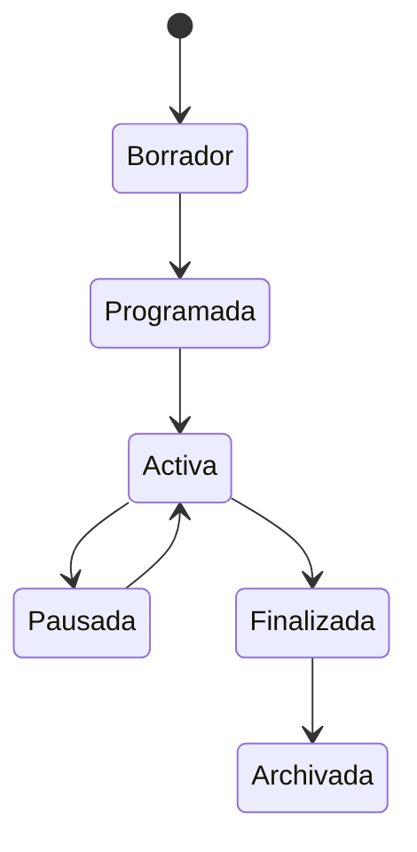

# <Nombre del módulo>

## 1. Contexto y objetivo

- **Qué gobierna:** qué canales B2C impacta (App, eCommerce, ADK, Web) y en qué mercados.
- **Quién lo usa:** rol, frecuencia, volumen (¿10 registros o 10.000?).
- **Riesgo operativo:** qué se rompe si se configura mal.
- **Métrica de éxito:** tiempo por tarea, clics, errores de configuración, tickets a soporte…

## 2. Entidad y estados

| Campo clave | Tipo | Obligatorio | Default / herencia |
|---|---|---|---|
| … | … | … | Hereda de Country › … |

## 3. Flujo

| # | Pantalla | Node | Patrón | Entrada | Salida |
|---|---|---|---|---|---|
| 1 | Listado | [`0:0`](https://www.figma.com/design/<key>/?node-id=0-0) | Card List / tabla | Panel izquierdo | Detalle · Crear |

### Flujo actual vs. propuesto (V2)

| Paso | Actual | Propuesto | Clics (actual → V2) | Regla |
|---|---|---|---|---|
| … | … | … | … | BO-… |

## 4. Anatomía y componentes

| Zona | Componentes (`DashBoard Foundation`) | Notas |
|---|---|---|
| Header del paso | `Link` volver · stepper | |
| Contenido | … | |
| Footer | Cancelar · Siguiente / Guardar | |

## 5. Casos borde y safety nets

| Caso | Comportamiento | Regla |
|---|---|---|
| Vacío | | BO-EST-03 |
| Error de integración | | BO-EST-03 |
| Eliminar / desactivar | Confirmación + soft-delete | BO-SEG-01/02 |
| Publicar | Resumen de alcance | BO-SEG-03 |
| Salir sin guardar | Aviso | BO-SEG-04 |
| Acción masiva | Contador + deshacer | BO-SEG-05 |
| Sin permisos | | BO-PER-02 |

## 6. Contenido (copy)

| Key | Texto | Contexto de voz y tono |
|---|---|---|
| `…` | … | Confirmaciones / Errores / Estados vacíos… |

## 7. Permisos (RBAC)

| Acción | Admin global | Admin país | Operador restaurante | Solo lectura |
|---|---|---|---|---|
| Ver | | | | |
| Crear / editar | | | | |
| Publicar | | | | |
| Eliminar | | | | |

## 8. Historias de usuario y criterios de aceptación

**HU-<MOD>-01** · Como <rol>, quiero <acción>, para <resultado>.

- **Dado** … **cuando** … **entonces** …

## 9. Justificación de decisiones

| Decisión | Por qué | Base |
|---|---|---|
| … | … | [Ley de …](../../Base-de-conocimiento/leyes-de-ux.md) · BO-… · WCAG … |

## 10. Hallazgos abiertos

| ID | Hallazgo | Prioridad | Estado |
|---|---|---|---|
| — | — | — | — |

## 11. Handoff

- Componentes Vue: [`Archway/Dashboard/ui`](../../Archway/Dashboard/ui/README.md).
- Tokens: [`dashboard.tokens.json`](../../Archway/Dashboard/tokens/dashboard.tokens.json) (Light + Dark).
- Endpoints y dependencias de backend: …
- Eventos de analytics: …
